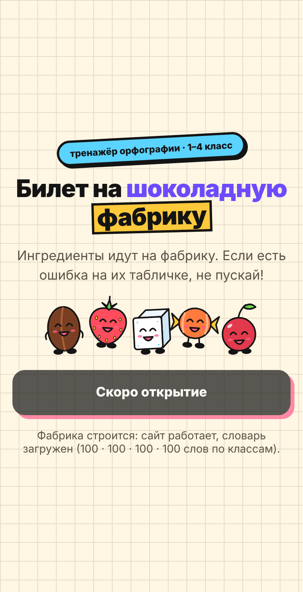
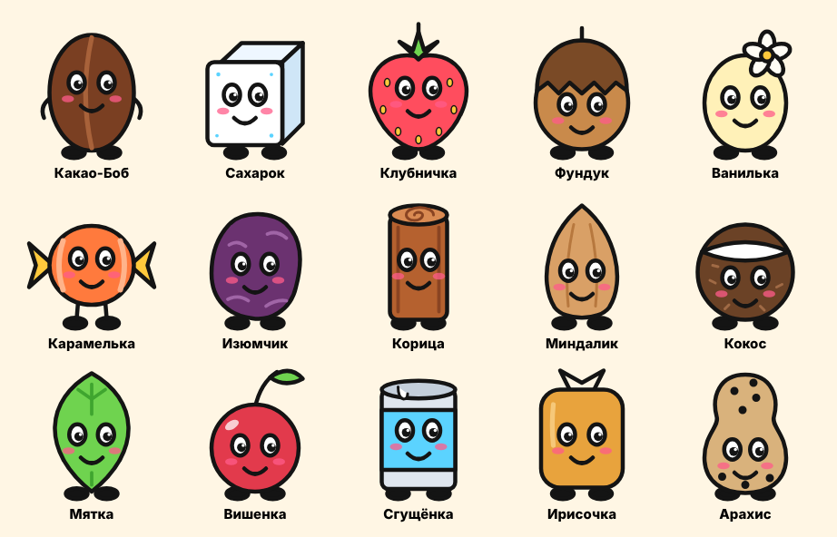

<div align="center">

# 🎫 Билет на шоколадную фабрику

**Тренажёр орфографии для школьников 1–4 класса**

Ингредиенты идут на шоколадную фабрику. Если есть ошибка на их табличке, не пускай!

### [▶ Играть](https://polinakychakova-new.github.io/bilet-na-fabriku/)

Без регистрации · бесплатно · на телефоне и на компьютере

> 🚧 Игра в разработке: сейчас по ссылке открывается заставка фабрики.



</div>

---

## Как играть

1. **Выбери класс** — от 1 до 4. Все уровни открыты сразу.
2. К проходной фабрики по очереди подходят **10 персонажей-ингредиентов**. У каждого в руках табличка со словом (1–2 класс) или словосочетанием (3–4 класс).
3. Если на табличке **всё написано верно** — нажми **«Пропустить дальше»**.
4. Если видишь **ошибку** — нажми **«Не пускать»**, а потом **нажми на букву с ошибкой**. Пока ошибка не найдена, персонаж не уйдёт. После двух промахов игра подскажет, где искать.
5. После каждого ответа сразу видно правильное написание.
6. В конце ты получаешь **золотой билет** с результатом: сколько верных ответов из 10.

Каждая игра — новые 10 слов из словаря класса, и каждый раз от 3 до 7 из них написаны с ошибкой. Угадать по шаблону не получится.

## Что тренируем

В словаре **400 записей — по 100 на каждый класс**, подобранных по школьной программе.

| Класс | Формат | Правила |
|:---:|---|---|
| **1** | слова | жи-ши, ча-ща, чу-щу · заглавная буква в именах, кличках и названиях городов и рек · словарные слова |
| **2** | слова | чк, чн, нч, щн без Ь · парные согласные · безударные гласные · разделительный Ь · двойные согласные · словарные слова |
| **3** | словосочетания | непроизносимые согласные · разделительный Ъ · удвоенные согласные · приставки · окончания прилагательных · Ь после шипящих · словарные слова |
| **4** | словосочетания | падежные окончания существительных и прилагательных · Ь в глаголах после шипящих · -тся / -ться · личные окончания глаголов · словарные слова |

Для каждого слова заранее подготовлены типичные детские ошибки («малако», «жыраф», «сьел конфету»), а не случайные опечатки. Каждая запись проходит автоматическую проверку:

- в ошибочном варианте **ровно одна** ошибка;
- в словосочетании ошибка всегда **внутри одного слова**;
- место ошибки, на которое нужно нажать, вычисляется программой;
- слова не повторяются ни внутри класса, ни между классами.

## Персонажи

15 ингредиентов, у каждого три настроения: ждёт у проходной, радуется, когда прошёл, и хмурится, если не пустили.

<div align="center">

</div>

## Для родителей и учителей

- 🔒 **Никаких данных о детях.** Нет регистрации, нет рекламы, нет счётчиков и cookie.
- 📱 **Работает в браузере** на любом телефоне, планшете и компьютере. Ничего не нужно устанавливать.
- 🔇 **Без озвучки**: орфографию проверяем глазами. Звуковые эффекты можно будет выключить.

---

## Для разработчиков

### Устройство проекта

Сайт полностью статический: обычные HTML, CSS и JavaScript без сборки, сервера и базы данных. Его можно разместить на любом хостинге простым копированием файлов.

```
├── index.html              главная страница
├── assets/
│   ├── css/style.css       стили: палитра, шрифты, кнопки
│   ├── js/app.js           логика игры
│   ├── js/characters.js    персонажи (SVG в коде, 3 состояния)
│   └── favicon.svg         иконка вкладки
├── data/
│   ├── words.json          словарь для игры (собирается скриптом)
│   └── words.csv           тот же словарь таблицей — удобно читать в Excel
├── tools/
│   └── build_words.py      исходный словарь + автоматическая проверка
└── docs/                   картинки для этого README
```

### Запуск на своём компьютере

```bash
git clone https://github.com/polinakychakova-new/bilet-na-fabriku.git
cd bilet-na-fabriku
python3 -m http.server 8000
```

Откройте <http://localhost:8000>. Простой двойной клик по `index.html` не подойдёт: браузер не даст загрузить словарь из файла.

### Как изменить словарь

Словарь хранится в `tools/build_words.py` в виде списков по классам:

```python
("молоко", "словарное", ["малоко", "молако"]),
#  правильно   правило     ошибочные варианты
```

После правки запустите:

```bash
python3 tools/build_words.py data
```

Скрипт проверит все записи, вычислит место ошибки и пересоберёт `data/words.json` и `data/words.csv`. Если что-то не так, например в варианте две ошибки, он напишет, где именно.

### Публикация

Сайт публикуется через **GitHub Pages** из ветки `main` (корень репозитория). Любое изменение в `main` появляется на сайте через 1–2 минуты.

## План разработки

Каждый этап закрывается контрольной точкой. Следующий этап не начинается, пока предыдущий не принят.

- [x] **Этап 0.** Требования и техническое задание
- [x] **Этап 1.** Словарь: 4 класса × 100 записей, автоматическая проверка
- [x] **Этап 2.** Серый прототип: механика проверена и принята
- [x] **Этап 3.** Визуальный стиль, 15 персонажей, макеты экранов
- [ ] **Этап 4.** Каркас сайта опубликован, ссылка открывается из России на телефоне и компьютере
- [ ] **Этап 5.** Игровая логика с автотестами
- [ ] **Этап 6.** Финальный интерфейс, анимации, адаптивность
- [ ] **Этап 7.** Звуковые эффекты
- [ ] **Этап 8.** Тестирование на устройствах и с детьми
- [ ] **Этап 9.** Релиз
